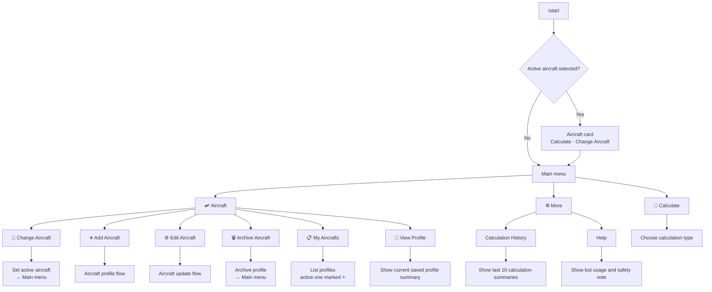
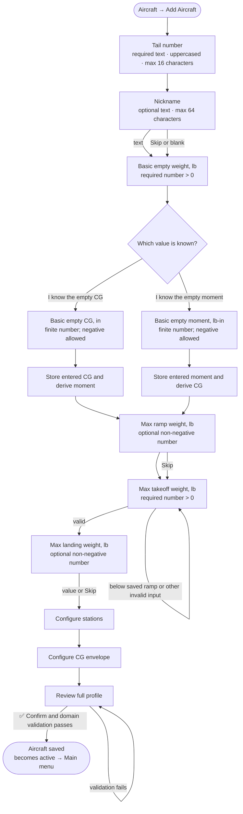
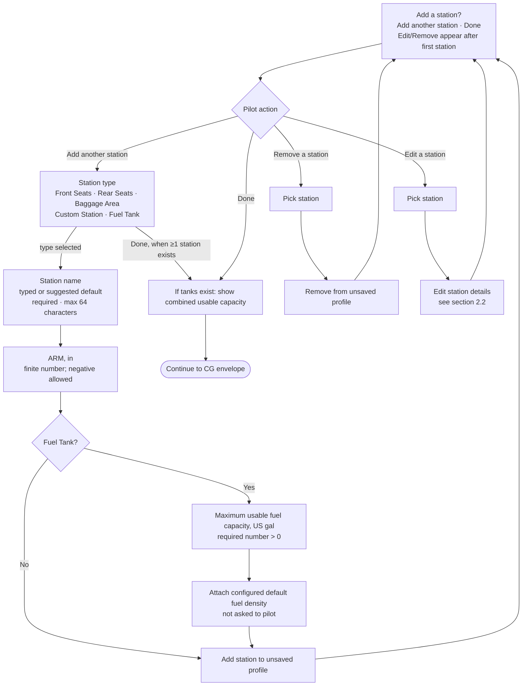
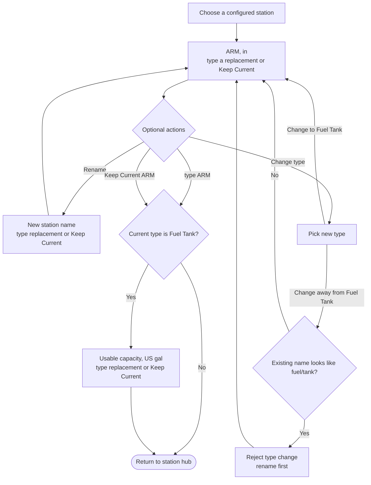
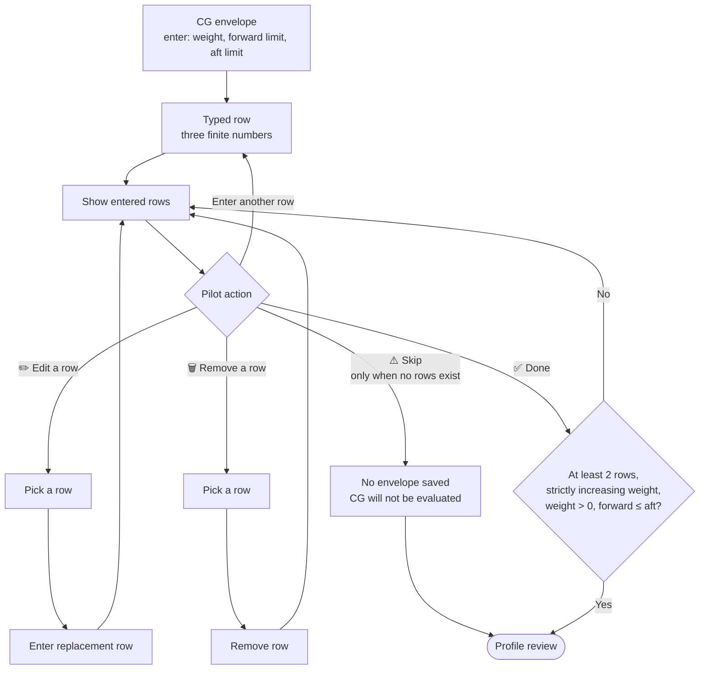
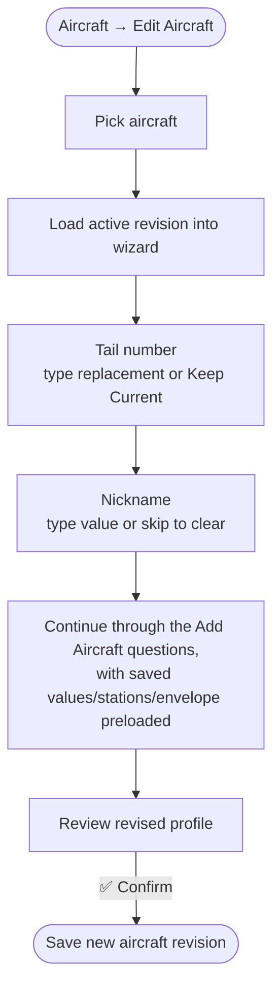
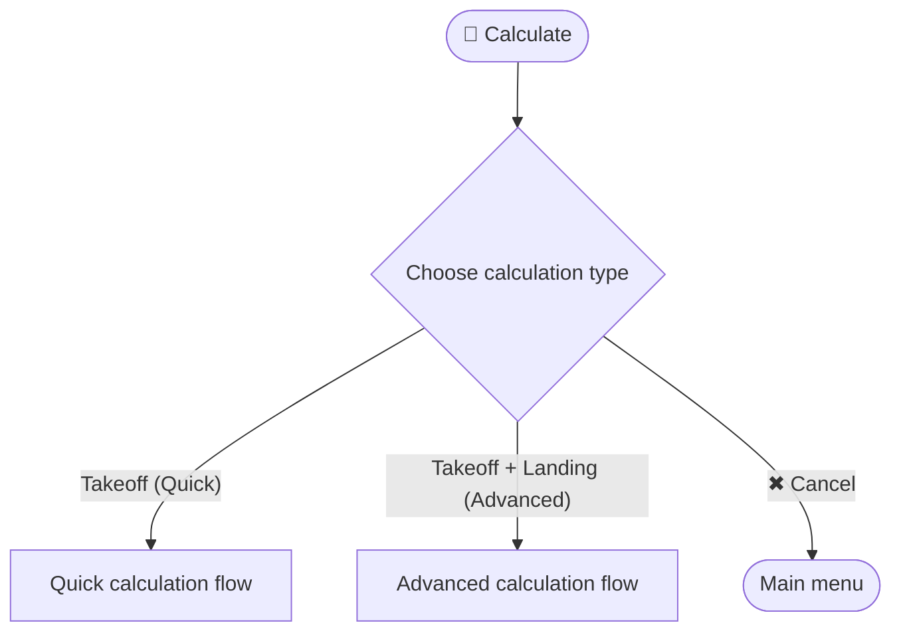
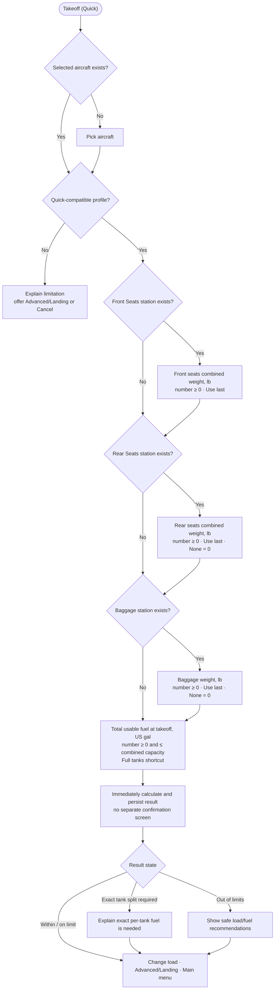
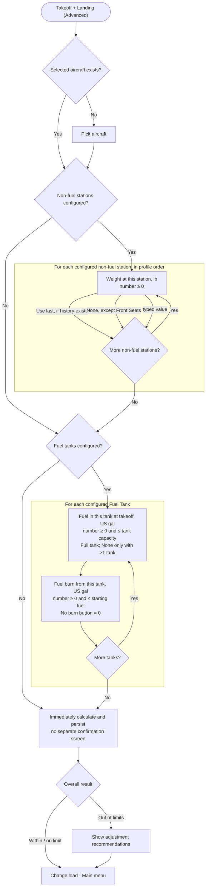
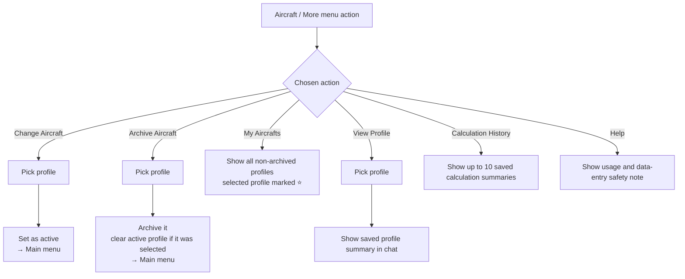

# Safe Pilot — Telegram user-flow map

This is the editable, code-aligned map of every pilot-facing question, button, branch, and result path in the Safe Pilot Telegram bot.

**Baseline:** commit `89bf658` plus the 2026-10-25 flow-audit fixes (see Changelog). Supersedes the older flow document; earlier history is in git.
**Notation:** rectangles are bot screens/questions; diamonds are decisions; arrow labels are the pilot’s answer or button. Every Mermaid diagram can be edited directly in Markdown and rendered by GitHub, GitLab, VS Code extensions, or Mermaid Live.

## Flow index

| Flow | Entry | Purpose |
|---|---|---|
| Main navigation | `/start`, `/menu` | Reaches calculations, aircraft actions, history, and help |
| Aircraft profile | **Aircraft → Add Aircraft** | Creates a reusable aircraft profile |
| Aircraft update | **Aircraft → Edit Aircraft** | Loads an existing profile and saves a new revision |
| Quick calculation | **Calculate → Takeoff (Quick)** | Fast takeoff check with combined loads and total fuel |
| Advanced calculation | **Calculate → Takeoff + Landing (Advanced)** | Per-station / per-tank calculation, including landing |
| Supporting actions | Aircraft / More menus | Select, archive, view profile, history, help |

## Shared interaction rules

- **Cancel:** inline `✖ Cancel` clears the active wizard and returns to the main menu. The command `/cancel` does the same.
- **Back:** returns to the prior question when that screen has history. For repeated station/tank questions, it returns to the exact prior item.
- **Invalid input:** the bot shows an error and remains on the same question; no partial profile or calculation is saved.
- **Units:** weights are lb, arms/CG are inches, moments are lb-in, and fuel is US gal.
- **Save point:** profile data is only persisted after **✅ Confirm**. Calculations are persisted immediately after their last answer; there is no separate confirmation screen in either calculation flow.

---

## 1. Main navigation

The aircraft card is only shown on `/start` when a selected aircraft exists. Its **Calculate** button opens the same calculation-type chooser; **Change Aircraft** opens the aircraft picker.

---

## 2. Aircraft profile: Add Aircraft

The new-profile wizard collects only the data used to calculate weight, moment, and CG. Aircraft becomes the active aircraft only after its profile is confirmed and saved.

Additional save-time validation protects the profile even when individual fields were valid: takeoff/ramp/landing limits cannot be below basic empty weight; ramp cannot be below takeoff; fuel stations need a positive capacity and density; and a completed CG envelope must be valid.

### 2.1 Station configuration loop

Important rules:

- A non-fuel station whose name contains a standalone word **fuel**, **tank**, or **tanks** is rejected. The pilot must use the **Fuel Tank** type.
- Fuel capacity is stored in gallons; its density comes from `DEFAULT_FUEL_DENSITY_LB_PER_GAL` (default: 6.0 for 100LL).
- Stations are still editable/removable until the final profile confirmation. Finalizing a station returns to the hub; it does not save the aircraft yet.
- The station hub offers **Back** (when the wizard has history) and **✖ Cancel**, like every other step.

### 2.2 Edit a station

Changing to **Fuel Tank** clears any old capacity and then requires a new positive capacity. Changing away from **Fuel Tank** clears the capacity and density. A fuel-like station name blocks a change away from Fuel Tank.

### 2.3 CG-envelope entry

The pilot may skip the envelope deliberately. In that case, calculation results evaluate saved weight limits but clearly mark CG as **not evaluated**.

---

## 3. Aircraft update: Edit Aircraft

**Aircraft → Edit Aircraft** first asks the pilot to choose a saved aircraft. The current revision is loaded into the same profile wizard used for creation. The pilot may change values, maintain its station/envelope setup, or use the current values where that control is supported. Confirming creates a **new revision**, so prior calculation records still refer to the previous profile revision.

In edit mode the nickname screen offers **✅ Keep Current** (keeps the saved nickname) and **Skip** (clears it).

---

## 4. Calculation-type choice

Before either flow starts, the bot uses the selected aircraft if one exists; otherwise, it asks the pilot to pick an aircraft. If none exists, it asks the pilot to add an aircraft instead.

---

## 5. Takeoff: Quick calculation

Quick calculation can only represent a profile with at most one Front Seats station, one Rear Seats station, one Baggage station, any number of Fuel Tanks, and no Custom / legacy Passenger stations. If the profile does not meet that condition, the bot explains why and offers **Advanced/Landing** instead.

Notes:

- A prompt is skipped entirely if its matching station type is absent.
- **Back** becomes available after the first question. **Cancel** is always available. Despite an older document in the archive, Quick calculation now supports Back.
- **Change load** restarts Quick for the same aircraft and offers the just-entered front/rear/baggage values as **Use last** shortcuts. Fuel is entered again.
- **Advanced/Landing** after a Quick result carries the compatible front/rear/baggage values forward and starts at the per-tank fuel questions.
- With multiple tanks at different arms, Quick uses total fuel honestly: it returns a possible CG range rather than inventing a tank split. If some possible splits are safe and others are not, it asks the pilot to run Advanced with actual tank quantities.

---

## 6. Takeoff + Landing: Advanced calculation

Advanced calculation supports every configured non-fuel station and every tank individually. It produces ramp/takeoff/landing evaluations from the loads and per-tank fuel data.

Notes:

- **Back** follows the exact station/tank sequence. **Cancel** returns to the main menu.
- **Change load** restarts Advanced for the same aircraft and offers the saved station loads as **Use last** shortcuts. Fuel is entered again.
- The Advanced result includes the pilot’s inputs, then the phase results. Ramp and takeoff are collapsed into one displayed phase when their weights are identical.
- The fuel-burn prompt has **No burn (0 gal)**, **Back** and **Cancel**. **No burn** records an explicit 0, so the landing condition is still evaluated. There is deliberately no **Skip**: skipping once silently disabled landing evaluation for every tank.
- **Known limitation:** the wizard asks for fuel at takeoff, not at ramp, and taxi burn is stored as 0. The ramp phase therefore always equals the takeoff phase and is shown as one combined phase; the ramp weight limit is not independently exercised by taxi/run-up fuel.

---

## 7. Supporting actions

---

## Source map for future updates

| Change needed | Source of truth |
|---|---|
| Menu labels, question wording, error copy | `app/bot/texts/i18n.py` |
| Add/edit profile states and branches | `app/bot/handlers/aircraft_wizard.py`, `app/bot/handlers/aircraft_update.py`, `app/bot/states/aircraft_wizard.py` |
| Main menu and supporting actions | `app/bot/handlers/menu.py`, `app/bot/keyboards/common.py` |
| Quick calculation questions / branches | `app/bot/handlers/quick_calculate.py`, `app/bot/states/quick_calc_wizard.py` |
| Advanced calculation questions / branches | `app/bot/handlers/flight_calculation.py`, `app/bot/states/flight_wizard.py` |
| Shared Back behavior | `app/bot/handlers/wizard_nav.py` |
| Input parsing and units | `app/bot/handlers/_common.py`, `app/domain/units.py` |
| Result math / compatibility rules | `app/domain/quick_calculation.py`, `app/domain/calculator.py`, `app/domain/envelope.py` |
| Recommendation logic | `app/domain/quick_recommendations.py`, `app/domain/recommendations.py` |

When a flow changes, update the relevant diagram in this file in the same pull request. The test suites `tests/test_bot_ui.py` and `tests/test_wizard_end_to_end.py` are the closest behavioural checks for the documented interaction flow.

---

## Changelog

### 2026-10-25 flow audit
- Edit Aircraft: **✅ Keep Current** on the nickname screen now works (it previously had no handler).
- Advanced calculation: added **No burn (0 gal)** button on the fuel-burn prompt.
- Add Aircraft: the station hub now has **Back** and **✖ Cancel**.
- Advanced result header changed from "Please confirm your inputs:" to "Your inputs:" (no confirmation step exists).
- **Download Data** renamed **View Profile**; it only ever showed the saved profile in chat. The callback and handler names are unchanged.
- Removed unused strings: `status_incomplete`, `btn_yes`, `btn_no`.
